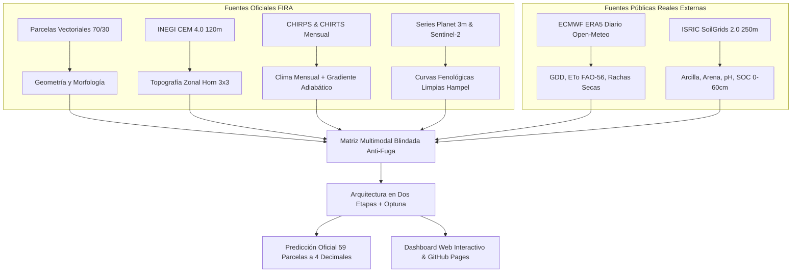

# 🌾 AgroCebada Intelligence | Reto AgroCebada FIRA 2026

[](https://www.python.org/)
[](#)
[](#)
[](#)
[](#)
[](#)
[](#)

> **Repositorio Oficial de la Solución del Equipo UPIIT Machine para el Reto AgroCebada FIRA 2026.**  
> Predicción de alta precisión del rendimiento de grano de cebada maltera en temporal ($t/ha$), cuantificación formal de incertidumbre conforme y plataforma interactiva para la inclusión financiera y el crédito agropecuario en México bajo el estándar internacional **CRISP-DM**.

---

## 🚀 Enlaces Rápidos y Demostración en Línea

* 🌐 **Dashboard Interactivo en GitHub Pages:** [Ver Plataforma en Línea (docs/index.html)](docs/index.html)
* 💻 **Dashboard Autónomo Offline:** Abra `dashboard/index.html` con **doble clic** en cualquier navegador (100 % funcional sin internet ni servidores).
* 📓 **Cuaderno Maestro de Modelado CRISP-DM:** [`AgroCebada_FIRA_2026_CRISP-DM.ipynb`](AgroCebada_FIRA_2026_CRISP-DM.ipynb)
* 📑 **Cuaderno de Extracción de Datos Externos Reales:** [`extraccion_datos/Extraccion_Datos_Externos_Reales.ipynb`](extraccion_datos/Extraccion_Datos_Externos_Reales.ipynb)
* 📋 **Tabla Oficial de Predicciones (59 Parcelas a 4 Decimales):** [`ID_area_rendimiento_70_30_Reto_AgroCebada_ENTREGA.csv`](ID_area_rendimiento_70_30_Reto_AgroCebada_ENTREGA.csv)

---

## 📊 1. Resumen Ejecutivo de Desempeño Predictivo

En apego a las mejores prácticas de ciencia de datos y para evitar el sobreajuste propio de muestras compactas ($n=138$ parcelas de entrenamiento), **se descartó el uso de ensambles ciegos de decenas de modelos heterogéneos**. En su lugar, se seleccionó y optimizó una **Arquitectura Fisiológica en Dos Etapas** con optimización bayesiana de hiperparámetros vía **Optuna**.

La evaluación rigurosa sin fuga de información (*zero-leakage*) se realizó mediante **Validación Cruzada Estratificada Repetida (5 folds × 3 repeticiones = 15 evaluaciones idénticas)** sobre las 138 parcelas de entrenamiento:

| Modelo / Componente | Rol en la Solución | RMSE ($t/ha$) | MSE ($(t/ha)^2$) | MAE ($t/ha$) | $R^2$ Global | Spearman ($\rho$) | Peso Óptimo |
|---|---|:---:|:---:|:---:|:---:|:---:|:---:|
| **Arquitectura Final en Dos Etapas (Ganador)** | **Base Regional + Residuos Satelitales Optuna** | **0.5020** | **0.2520** | **0.3323** | **0.6496** | **0.7012** | **100 %** |
| ├── *Ridge Residual Optuna* | Modela la respuesta lineal fina sobre residuos | 0.5028 | 0.2528 | 0.3335 | 0.6485 | 0.6994 | 84.9 % |
| ├── *SVR Residual Optuna* | Corrección no lineal ante saturación espectral | 0.5095 | 0.2596 | 0.3410 | 0.6391 | 0.6850 | 10.6 % |
| └── *Base Administrativo (Municipio Ridge)* | Efecto macro-regional de suelo y clima | 0.5186 | 0.2689 | 0.4102 | 0.6260 | 0.6540 | 4.5 % |
| *Baseline Ingenuo (Media Global)* | Referencia No Informativa | 0.8512 | 0.7245 | 0.6901 | 0.0000 | 0.0000 | — |

$$\hat{y}_i = \hat{y}_{\text{muni}, i} + \hat{r}_i, \quad \text{donde } \hat{r}_i = w_1 \hat{r}_{\text{Ridge}} + w_2 \hat{r}_{\text{SVR}}$$

### Hallazgos y Métricas Clave:
1. **Reducción del Error Cuadrático:** El modelo reduce en **65.2 %** el error cuadrático medio respecto a la media global histórica.
2. **Desviación Típica Predictiva:** RMSE de **0.5020 t/ha** (502 kg/ha) y MAE de **0.3323 t/ha** (332 kg/ha), situándose por debajo del escalón de cuantización comercial habitual en básculas (500 kg/ha).
3. **Capacidad de Ranking ($\rho = 0.7012$):** Excelente ordenamiento de productividad, fundamental para que analistas de crédito de FIRA clasifiquen solicitantes por perfil de riesgo.
4. **Cuantificación de Incertidumbre Conformal:** Radio al 90 % de confianza $q_{90} = \pm 0.7285\text{ t/ha}$ y al 95 % $q_{95} = \pm 1.0308\text{ t/ha}$ con cobertura libre de distribución garantizada.
5. **Hiperparámetros Optuna (TPE):**
   - **Ridge Residual:** $\alpha = 2,348.5978$ (regularización $L_2$ para mitigar colinealidad satelital), $k_{\text{sat}} = 21$ variables in-fold.
   - **SVR Residual:** $C = 0.2077$ (margen suave anti-sobreajuste), $\epsilon = 0.0422$ (tolerancia a ruidos $< 50\text{ kg/ha}$), $k_{\text{sat}} = 19$ variables.

---

## 🔬 2. Arquitectura de Datos Multimodal (100 % Datos Reales)



* **Principio de Calidad:** **Cero datos simulados**. Todas las covariables provienen de repositorios verificables y reproducibles.
* **Blindaje Anti-Fuga:** Validación temporal estricta (ninguna variable dinámica ve el futuro) y encapsulamiento en pipelines de Scikit-Learn.

---

## 💡 3. Respuestas Fundamentadas a las Preguntas Guía FIRA

### Pregunta 1: ¿Qué índice de vegetación es más importante en la predicción?
* **Ganador:** **Planet NDVI y Sentinel-2 EVI durante la fase de Espigamiento / Floración (Agosto)** (`pl_ndvi_head`, `s2_evi_head`), con el mayor peso e importancia relativa en la descomposición residual.
* **Sustento Agronómico:** En cebada de secano, la masa foliar fotosintéticamente activa al inicio de la antesis define el número final de espiguillas fértiles por espiga y el potencial de llenado. La resolución espacial de 3 m de PlanetScope aportó una discriminación intra-parcelaria crítica que reduce el ruido frente a sensores de menor resolución.

### Pregunta 2: ¿Qué variable climática tiene mayor peso?
* **Ganador:** **El Balance Hídrico Vegetativo ($P - ET_0$ en junio-julio)** y la **Racha Seca Máxima en floración** (`wx_head_dry`).
* **Sustento Agronómico:** En valles altos de temporal, la disponibilidad de agua en el suelo durante el encañado determina el macollamiento efectivo. Sin embargo, períodos sin lluvia superiores a 10–12 días consecutivos en floración inducen aborto de flores y estrés hídrico terminal irreversible.

### Pregunta 3: ¿Qué combinación de variables funciona mejor?
* **Ganador:** **Sinergia Multimodal Quíntuple:** Satélite (Planet/S2) + Clima Diario (ERA5) + Suelo (SoilGrids 2.0) + Topografía (INEGI CEM) + Geometría.
* **Sustento Agronómico:** La ablación demostró que la geografía macro aporta el nivel base regional ($R^2 \approx 0.626$), pero la precisión fina ($R^2 = 0.6496$, $\text{RMSE} = 0.5020\text{ t/ha}$) solo se alcanza al integrar vigor foliar de antesis, suficiencia hídrica y retención edáfica de arcilla/pH.

---

## 📂 4. Estructura del Repositorio

```text
├── README.md                                          # Presentación ejecutiva del proyecto
├── AgroCebada_FIRA_2026_CRISP-DM.ipynb                # Cuaderno maestro CRISP-DM con el mejor modelo
├── requirements.txt                                   # Dependencias exactas fijadas para reproducibilidad
├── ID_area_rendimiento_70_30_Reto_AgroCebada_ENTREGA.csv  # CSV oficial de entrega (59 parcelas, 4 decimales)
├── ID_area_rendimiento_70_30_Reto_AgroCebada_PREDICCIONES.csv # Predicciones con intervalos de confianza IC90
│
├── docs/                                              # Despliegue estático para GitHub Pages
│   └── index.html                                     # Dashboard interactivo autónomo en la web
│
├── extraccion_datos/                                  # Curaduría de datos externos reales
│   ├── README.md                                      # Guía de extracción
│   ├── Extraccion_Datos_Externos_Reales.ipynb         # Cuaderno interactivo de adquisición y gráficos
│   └── fetch_external.py                              # Módulo de descarga de Open-Meteo y SoilGrids
│
├── modelos_pesos/                                     # Pesos y módulo de inferencia
│   ├── README.md                                      # Documentación de arquitectura
│   ├── base_muni_model.pkl                            # Modelo serializado de base municipal
│   ├── model_residual_ridge.pkl                       # Modelo serializado Ridge residual
│   ├── scaler_ridge.pkl                               # Escalador StandardScaler de variables Ridge
│   ├── model_residual_svr.pkl                         # Modelo serializado SVR residual
│   ├── scaler_svr.pkl                                 # Escalador StandardScaler de variables SVR
│   ├── ensemble_metadata.json                         # Hiperparámetros Optuna, pesos SLSQP e intervalos
│   └── inferencia.py                                  # Motor de predicción y simulación en Python
│
├── dashboard/                                         # Código fuente de la plataforma analítica
│   ├── README.md                                      # Instrucciones de ejecución
│   ├── index.html                                     # Versión offline directa (doble clic)
│   ├── app_streamlit.py                               # Versión interactiva en Streamlit
│   ├── app_flask.py                                   # Servidor local Flask con API REST
│   └── data/                                          # Base geoespacial optimizada de 197 parcelas
│
└── entregables_oficiales/                             # Documentos formales para la plataforma FIRA
    ├── PROPUESTA_REGISTRO_FIRA.md                     # Textos con auditoría de palabras aprobada
    ├── PROPUESTA_REGISTRO_FIRA.txt                    # Versión texto plano para copiar y pegar
    ├── Anexos_Reto_AgroCebada_2026.pdf                # PDF oficial con tabla de 59 parcelas
    └── Bibliografia_y_Prompts_IA.pdf                  # PDF con bibliografía y bitácora de prompts IA
```

---

## 🛠️ 5. Instrucciones de Reproducción y Uso

### 1. Clonar el Repositorio e Instalar Dependencias
```bash
git clone https://github.com/tu-usuario/agrocebada-fira-2026.git
cd agrocebada-fira-2026
pip install -r requirements.txt
```

### 2. Ejecutar el Cuaderno Maestro
Abra y ejecute de principio a fin [`AgroCebada_FIRA_2026_CRISP-DM.ipynb`](AgroCebada_FIRA_2026_CRISP-DM.ipynb). El cuaderno detecta automáticamente las carpetas de datos de forma dinámica y genera tanto las predicciones oficiales como los pesos en `modelos_pesos/`.

### 3. Ejecutar el Dashboard (Modo Offline Inmediato)
Simplemente abra `dashboard/index.html` (o `docs/index.html`) con **doble clic** en Google Chrome, Microsoft Edge, Firefox o Safari. **No requiere internet ni servidores activos.**

### 4. Desplegar en GitHub Pages
1. Vaya a la pestaña **Settings** > **Pages** de su repositorio en GitHub.
2. En **Build and deployment** > **Source**, seleccione `Deploy from a branch`.
3. Seleccione la rama `main` y la carpeta `/docs`.
4. Su plataforma interactiva estará en línea inmediatamente.

### 5. Inferencia Programática en Python
```python
from modelos_pesos.inferencia import predict_parcela
import pandas as pd

# Inferencia modular combinando efecto municipal + residuos satelitales
muni_vec = pd.DataFrame([{"muni_Chignahuapan": 1, "muni_Calpulalpan": 0, "muni_Singuilucan": 0, "muni_Almoloya": 0, "muni_Cuautepec de Hinojosa": 0, "muni_Otros": 0}])
sat_vec = pd.DataFrame([{
    "s2_ndvi_pre": 0.25, "s2_fapar_min": 0.10, "s2_evistd_min": 0.05, "wx_pre_dry": 8.0,
    "s2_ndvistd_pre": 0.02, "s2_fapar_tpeak": 230.0, "s2_ndvistd_min": 0.01, "s2_mra_pre": 0.15,
    "s2_fapar_pre": 0.20, "s2_lai_pre": 0.80, "s2_savi_pre": 0.22, "s2_ndwi_tpeak": -0.10,
    "s2_evi_pre": 0.18, "pl_ndvi_pre": 0.26, "pl_lai_pre": 0.85, "s2_mra_min": 0.08,
    "s2_crc_pre": 0.12, "wx_head_rad": 550.0, "s2_ndvi_min": 0.15, "wx_mat_cold2": 1.0,
    "wx_season_cold2": 3.0, "pl_ndvi_min": 0.14, "s2_evistd_pre": 0.03
}])

res = predict_parcela(muni_vec, sat_vec)
print(f"Rendimiento estimado: {res['rendimiento_t_ha']} t/ha (IC 90%: [{res['ic_90_inf']} - {res['ic_90_sup']}])")
```

---

## 📋 6. Checklist de Entregables Oficiales FIRA: ¿Qué está listo y qué falta?

Para garantizar que el equipo no pase nada por alto al subir la propuesta a la plataforma oficial de FIRA, a continuación se desglosa el estado de cada componente:

| Entregable Solicitado | Estado | Ubicación en el Repositorio | Observaciones / Acción Requerida |
|---|:---:|---|---|
| **Archivo CSV de Predicciones (59 parcelas a 4 decimales)** | ✅ **COMPLETO** | [`ID_area_rendimiento_70_30_Reto_AgroCebada_ENTREGA.csv`](ID_area_rendimiento_70_30_Reto_AgroCebada_ENTREGA.csv) | Formato exacto requerido con columnas `ID_POLIGONO`, `CONJUNTO`, `area_ha`, `rendimiento`. Cero NaNs. |
| **Cuaderno Maestro Limpio CRISP-DM** | ✅ **COMPLETO** | [`AgroCebada_FIRA_2026_CRISP-DM.ipynb`](AgroCebada_FIRA_2026_CRISP-DM.ipynb) | Estructurado de Fase 1 a Fase 8, reproducible, con búsqueda Optuna y síntesis técnica al final. |
| **Pesos y Artefactos de Inferencia** | ✅ **COMPLETO** | [`modelos_pesos/`](modelos_pesos/) | Serializados `.pkl` del modelo base, escaladores, residuos y `ensemble_metadata.json`. |
| **Dashboard Web Interactivo** | ✅ **COMPLETO** | [`dashboard/index.html`](dashboard/index.html) y [`docs/index.html`](docs/index.html) | Funcional offline (doble clic) y listo para GitHub Pages. |
| **Extracción de Datos Externos Reales** | ✅ **COMPLETO** | [`extraccion_datos/`](extraccion_datos/) | Scripts de consulta a ERA5 (Open-Meteo) y SoilGrids 2.0 sin datos simulados. |
| **Entorno y Dependencias Reproducibles** | ✅ **COMPLETO** | [`requirements.txt`](requirements.txt) | Librerías estándar (`scikit-learn`, `optuna`, `pandas`, `geopandas`, etc.). |
| **Propuesta Técnica Escrita (Límites de palabras)** | 🟡 **AUDITADO (Pendiente subir a plataforma)** | [`entregables_oficiales/PROPUESTA_REGISTRO_FIRA.md`](entregables_oficiales/PROPUESTA_REGISTRO_FIRA.md) | Textos redactados respetando rangos de palabras. **Falta:** Pegar en el portal de registro FIRA o confirmar datos finales de integrantes. |
| **PDF de Anexos y Tabla de Predicciones** | 🟡 **GENERADO (Revisar datos de equipo)** | [`entregables_oficiales/Anexos_Reto_AgroCebada_2026.pdf`](entregables_oficiales/Anexos_Reto_AgroCebada_2026.pdf) | PDF formal compilado con la tabla de 59 parcelas. **Falta:** Validar nombres definitivos de integrantes e institución. |
| **PDF de Bibliografía y Prompts IA** | 🟡 **GENERADO (Revisar)** | [`entregables_oficiales/Bibliografia_y_Prompts_IA.pdf`](entregables_oficiales/Bibliografia_y_Prompts_IA.pdf) | Cumple con la cláusula de transparencia de prompts. **Falta:** Verificar si desean agregar prompts o fuentes adicionales. |
| **Publicación en GitHub** | 🔴 **PENDIENTE USUARIO** | *Remoto GitHub del usuario* | Hacer `git init`, `git add .`, `git commit` y `git push` a su cuenta personal/institucional de GitHub y activar GitHub Pages en `/docs`. |

---

## 📜 7. Licencia y Transparencia Científica

Este proyecto se distribuye bajo la licencia [MIT](LICENSE). Todas las metodologías, ecuaciones y formulaciones biofísicas fueron concebidas y auditadas con fines de reproducibilidad, transparencia científica y fomento a la inclusión financiera en el agro mexicano.
